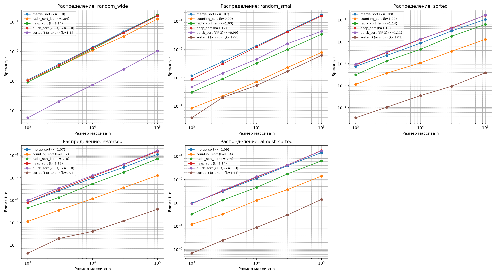

# Отчёт по лабораторной работе №4
**Тема:** MergeSort, Counting, Radix и HeapSort: оценка производительности  
**Вариант:** 7 (`seed = 37`)

---

## 1. Сводная таблица свойств алгоритмов сортировки

| Алгоритм | Лучший случай | Средний случай | Худший случай | Доп. память | Стабильность | Ограничения и особенности применимости |
|---|---|---|---|---|---|---|
| **`merge_sort`** | $\Theta(n \log n)$ | $\Theta(n \log n)$ | $\Theta(n \log n)$ | $O(n)$ | Да | Требует дополнительный буфер памяти $O(n)$ для слияния |
| **`counting_sort`** | $\Theta(n + k)$ | $\Theta(n + k)$ | $\Theta(n + k)$ | $O(n + k)$ | Да | Только целые ключи из $[0, k]$; неприменим при $k \gg n$ |
| **`radix_sort_lsd`** | $\Theta(d(n + b))$ | $\Theta(d(n + b))$ | $\Theta(d(n + b))$ | $O(n + b)$ | Да | Неотрицательные целые фиксированной разрядности $d$ (основание $b=10$) |
| **`heap_sort`** | $\Theta(n \log n)$ | $\Theta(n \log n)$ | $\Theta(n \log n)$ | $O(1)$ | Нет | Сортирует на месте (`in-place`), но имеет плохую локальность кэша |
| **`quick_sort` (ЛР 3)** | $\Theta(n \log n)$ | $O(n \log n)$ | $O(n^2)^*$ | $O(\log n)$ | Нет | *Рандомизация опорного элемента делает худший случай практически невозможным |
| **`sorted()` (Timsort)** | $\Theta(n)$ | $O(n \log n)$ | $O(n \log n)$ | $O(n)$ | Да | Гибрид MergeSort и InsertionSort на языке C в CPython |

---

## 2. Верификация и проверка стабильности

В функции `self_check()` выполнена автоматическая проверка корректности (`self_check: OK`):
1. **Граничные случаи:** проверена работа всех алгоритмов на пустом списке `[]`, массиве из одного элемента `[7]` / `[42]`, массиве из нулей `[0]` и массиве из одинаковых элементов `[5, 5, 5]`.
2. **Стабильность `merge_sort`:** протестирована на массиве из 100 пар `(ключ, порядковый_номер)` с повторяющимися ключами из диапазона $[0, 5]$. Результат полностью совпал со стабильным эталоном `sorted(pairs, key=lambda p: p[0])`. Стабильность обеспечивается нестрогим неравенством `key(left[i]) <= key(right[j])` в процедуре `merge()`.
3. **Стабильность `counting_sort` и `radix_sort_lsd`:** обеспечивается накоплением префиксных сумм в массиве счётчиков `counts` и обратным проходом по входному массиву (`for i in range(n - 1, -1, -1)`), при котором элементы с одинаковым ключом (или цифрой разряда) укладываются в выходной массив строго справа налево с сохранением исходного порядка.
4. **Инвариант перестановки и сверка с эталоном:** на 200 случайных массивах длины от 0 до 60 результаты всех реализаций совпали с `sorted(a)`.

---

## 3. Результаты бенчмарка (медиана по 5 повторам с прогревом)

### Распределение 1: `random_wide` (случайные ключи из $[0, 10^9]$)

| Алгоритм | $n=1000$ | $n=3000$ | $n=10000$ | $n=30000$ | $n=100000$ | Наклон $k$ (log-log) |
|---|---:|---:|---:|---:|---:|---:|
| **`merge_sort`** | 0.001090 c | 0.003607 c | 0.013743 c | 0.046273 c | 0.167276 c | 1.10 |
| **`counting_sort`** | пропуск | пропуск | пропуск | пропуск | пропуск | — |
| **`radix_sort_lsd`** | 0.001032 c | 0.003002 c | 0.010923 c | 0.032117 c | 0.124771 c | 1.04 |
| **`heap_sort`** | 0.000912 c | 0.003036 c | 0.012146 c | 0.042289 c | 0.168866 c | 1.14 |
| **`quick_sort` (ЛР 3)** | 0.001013 c | 0.003353 c | 0.013054 c | 0.042815 c | 0.159547 c | 1.10 |
| **`sorted()` (эталон)** | 0.000056 c | 0.000201 c | 0.000736 c | 0.002484 c | 0.010276 c | 1.12 |

### Распределение 2: `random_small` (узкий диапазон ключей $[0, 100]$)

| Алгоритм | $n=1000$ | $n=3000$ | $n=10000$ | $n=30000$ | $n=100000$ | Наклон $k$ (log-log) |
|---|---:|---:|---:|---:|---:|---:|
| **`merge_sort`** | 0.001167 c | 0.003698 c | 0.013230 c | 0.043107 c | 0.161542 c | 1.07 |
| **`counting_sort`** | 0.000084 c | 0.000225 c | 0.000714 c | 0.002293 c | 0.007776 c | 0.99 |
| **`radix_sort_lsd`** | 0.000304 c | 0.000907 c | 0.003246 c | 0.009867 c | 0.034074 c | 1.03 |
| **`heap_sort`** | 0.000879 c | 0.003069 c | 0.012127 c | 0.041532 c | 0.151036 c | 1.12 |
| **`quick_sort` (ЛР 3)** | 0.000473 c | 0.001432 c | 0.004503 c | 0.015959 c | 0.043254 c | 0.99 |
| **`sorted()` (эталон)** | 0.000038 c | 0.000200 c | 0.000532 c | 0.001666 c | 0.006117 c | 1.06 |

### Распределение 3: `sorted` (упорядоченный массив $0 \dots n-1$)

| Алгоритм | $n=1000$ | $n=3000$ | $n=10000$ | $n=30000$ | $n=100000$ | Наклон $k$ (log-log) |
|---|---:|---:|---:|---:|---:|---:|
| **`merge_sort`** | 0.000755 c | 0.002347 c | 0.008603 c | 0.030678 c | 0.103190 c | 1.08 |
| **`counting_sort`** | 0.000114 c | 0.000365 c | 0.001084 c | 0.003636 c | 0.012771 c | 1.02 |
| **`radix_sort_lsd`** | 0.000307 c | 0.001321 c | 0.004476 c | 0.017663 c | 0.061156 c | 1.14 |
| **`heap_sort`** | 0.000877 c | 0.003196 c | 0.012723 c | 0.041793 c | 0.158431 c | 1.13 |
| **`quick_sort` (ЛР 3)** | 0.000928 c | 0.003367 c | 0.013265 c | 0.039690 c | 0.161956 c | 1.11 |
| **`sorted()` (эталон)** | 0.000003 c | 0.000010 c | 0.000035 c | 0.000092 c | 0.000384 c | 1.01 |

### Распределение 4: `reversed` (обратно упорядоченный массив $n \dots 1$)

| Алгоритм | $n=1000$ | $n=3000$ | $n=10000$ | $n=30000$ | $n=100000$ | Наклон $k$ (log-log) |
|---|---:|---:|---:|---:|---:|---:|
| **`merge_sort`** | 0.000768 c | 0.002587 c | 0.009664 c | 0.028807 c | 0.110125 c | 1.07 |
| **`counting_sort`** | 0.000112 c | 0.000355 c | 0.001162 c | 0.003598 c | 0.012574 c | 1.02 |
| **`radix_sort_lsd`** | 0.000454 c | 0.001304 c | 0.005351 c | 0.017394 c | 0.069916 c | 1.10 |
| **`heap_sort`** | 0.000795 c | 0.002951 c | 0.011252 c | 0.038657 c | 0.148825 c | 1.13 |
| **`quick_sort` (ЛР 3)** | 0.000981 c | 0.003447 c | 0.012642 c | 0.039873 c | 0.162595 c | 1.10 |
| **`sorted()` (эталон)** | 0.000004 c | 0.000019 c | 0.000040 c | 0.000119 c | 0.000393 c | 0.94 |

### Распределение 5: `almost_sorted` (почти отсортированный массив, ~1% случайных обменов)

| Алгоритм | $n=1000$ | $n=3000$ | $n=10000$ | $n=30000$ | $n=100000$ | Наклон $k$ (log-log) |
|---|---:|---:|---:|---:|---:|---:|
| **`merge_sort`** | 0.000947 c | 0.003084 c | 0.011120 c | 0.038881 c | 0.141283 c | 1.09 |
| **`counting_sort`** | 0.000118 c | 0.000321 c | 0.001257 c | 0.003654 c | 0.013901 c | 1.04 |
| **`radix_sort_lsd`** | 0.000322 c | 0.001296 c | 0.004533 c | 0.017267 c | 0.062499 c | 1.14 |
| **`heap_sort`** | 0.000906 c | 0.003187 c | 0.012481 c | 0.041711 c | 0.173287 c | 1.14 |
| **`quick_sort` (ЛР 3)** | 0.000904 c | 0.003366 c | 0.013198 c | 0.041218 c | 0.168863 c | 1.13 |
| **`sorted()` (эталон)** | 0.000007 c | 0.000024 c | 0.000087 c | 0.000299 c | 0.001388 c | 1.14 |

---

## 4. Анализ графиков и сопоставление с асимптотикой

1. **Проблема диапазона ключей в `counting_sort` (`random_small` против `random_wide`):**
   * На распределении `random_small` ($k = 101 \ll n$) сложность $O(n + k)$ сводится к чистому линейному времени $O(n)$ (наклон $k \approx 0.99$). На $n = 100\,000$ `counting_sort` работает за $0.007776$ с, опережая все остальные алгоритмы на чистом Python более чем на порядок.
   * На `random_wide` ($k = 10^9 + 1$) выделение массива счётчиков `[0] * (10**9 + 1)` в Python потребовало бы $\approx 8$ ГБ оперативной памяти и миллиарда холостых итераций даже при $n = 1000$, поэтому при $k \gg n$ алгоритм полностью теряет практический смысл.
2. **Преимущество `radix_sort_lsd` на широком диапазоне:**
   * В отличие от `counting_sort`, поразрядная сортировка фиксирует основание системы счисления $b = 10$ и делает $d \le 10$ проходов для чисел до $10^9$. На `random_wide` ($n = 100\,000$) она показывает наклон $k \approx 1.04$ и время $0.124771$ с, опережая `merge_sort`, `heap_sort` и `quick_sort`.
   * На распределениях `sorted`, `reversed` и `almost_sorted` максимальное число в массиве равно $n$, поэтому число разрядов $d = \lfloor \log_{10} n \rfloor + 1$ растёт пропорционально $\log n$, из-за чего наклон на графике увеличивается до $1.10 - 1.14$.
3. **Гарантированные $\Theta(n \log n)$ в `merge_sort` и `heap_sort`:**
   * Оба алгоритма демонстрируют стабильные наклоны $1.07 - 1.14$ на всех распределениях. На упорядоченных и обратных данных `merge_sort` работает немного быстрее ($0.103 - 0.110$ с против $0.167$ с на случайных), так как при слиянии двух половин один из подмассивов исчерпывается целиком за один проход, а оставшийся копируется блоком `res.extend(...)`.
   * `heap_sort` не требует дополнительной памяти ($O(1)$), но на больших массивах немного уступает `merge_sort` и `quick_sort` из-за частых прыжков по индексам $2i+1$ и $2i+2$ (плохая пространственная локальность кэша процессора).
4. **Поведение `quick_sort` и `sorted()` (Timsort):**
   * Благодаря 3-way разбиению (на $<, =, >$) `quick_sort` на распределении `random_small` (где всего 101 уникальный ключ) ускоряется почти в 4 раза ($0.043254$ с, $k \approx 0.99$), так как дубликаты опорного элемента сразу занимают свои финальные места.
   * Встроенный `sorted()` (алгоритм Timsort на C) в 10–25 раз быстрее реализаций на чистом Python на случайных данных, а на `sorted` и `reversed` достигает лучшего случая $O(n)$ ($0.000384$ с на $n=100\,000$).

---

## 5. Ответы на контрольные вопросы (раздел 10 КИМ-04)

1. **Почему MergeSort стабилен и какое именно условие в шаге слияния обеспечивает стабильность?**  
   Стабильность гарантируется нестрогим неравенством `key(left[i]) <= key(right[j])` в функции `merge()`. Поскольку все элементы левой половины `left` в исходном массиве находились левее элементов правой половины `right`, выбор элемента из `left` при равенстве ключей сохраняет их исходный взаимный порядок.
2. **Какие ограничения накладывает диапазон ключей на CountingSort и как диапазон входит в оценки времени и памяти $O(n + k)$?**  
   Ключи должны быть целыми числами, адресуемыми как индексы массива. Алгоритм выделяет массив счётчиков длины $k = \max - \min + 1$ и проходит по нему для вычисления префиксных сумм, поэтому и время, и память составляют $\Theta(n + k)$. Если $k \gg n$ (например, $k = 10^9$), затраты памяти и времени определяются гигантским $k$, делая алгоритм неприменимым.
3. **Чем RadixSort отличается от CountingSort по модели памяти и области применимости и почему внутренняя поразрядная сортировка обязана быть устойчивой?**  
   RadixSort разбивает ключи на разряды по основанию $b$ (в нашей реализации $b = 10$) и использует буфер счётчиков размера $b$, требуя всего $O(n + b)$ памяти вместо $O(n + k)$. Это позволяет сортировать числа из огромного диапазона за $O(d(n + b))$. Внутренняя сортировка по разряду обязана быть устойчивой, чтобы при сортировке по старшему разряду не разрушался порядок элементов с одинаковой старшей цифрой, который был правильно установлен при сортировке по младшим разрядам.
4. **Почему HeapSort нестабилен, хотя работает за $O(n \log n)$ и in-place?**  
   При извлечении максимума корень кучи `a[0]` меняется местами с последним элементом неотсортированной части `a[end]`, после чего выполняется просейка вниз (`sift_down`). Такие «дальние» обмены перебрасывают элементы через большие участки массива без учёта того, какой из равных ключей встречался раньше во входном массиве.
5. **Как доказывается нижняя граница $\Omega(n \log n)$ для сортировок сравнением и почему CountingSort и RadixSort её обходят?**  
   Любой алгоритм, опирающийся только на попарные сравнения, можно представить бинарным деревом решений, где листья соответствуют $n!$ возможным перестановкам входа. В бинарном дереве высоты $h$ не более $2^h$ листьев, откуда $2^h \ge n! \implies h \ge \log_2(n!) = \Omega(n \log n)$ по формуле Стирлинга. CountingSort и RadixSort обходят эту границу, так как вообще не выполняют сравнений между элементами, а используют значения ключей (или цифр) напрямую для вычисления индексов в массиве за $O(1)$.