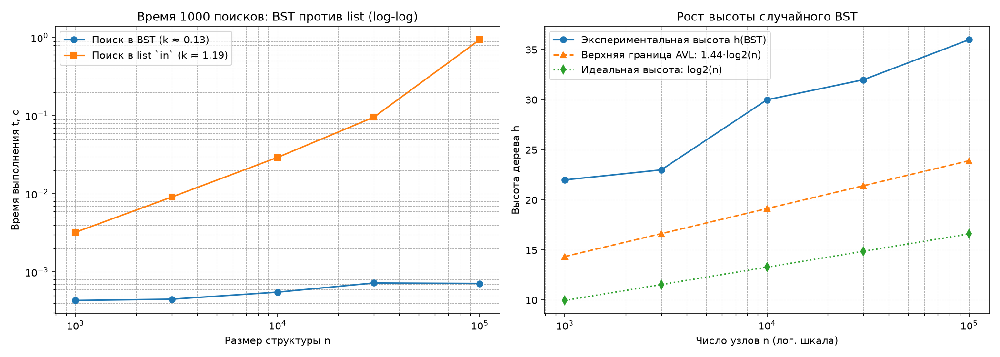

# Отчёт по лабораторной работе №5
**Тема:** Построение бинарного дерева поиска и реализация обходов; вставка и удаление элементов  
**Вариант:** 7 (seed = 37)

## 1. Асимптотические оценки операций BST

Все базовые операции модификации и поиска в бинарном дереве поиска (BST) выполняются путём спуска от корня к листьям, совершая на каждом уровне константное число сравнений и переходов по ссылкам:

* **Поиск (`search`):** $O(h)$ по времени и $O(1)$ по дополнительной памяти (итеративный спуск).
* **Вставка (`insert`):** $O(h)$ по времени и $O(1)$ по памяти.
* **Удаление (`delete`):** $O(h)$ по времени и $O(h)$ по памяти стека вызовов (включая поиск преемника в правом поддереве в случае узла с двумя детьми).
* **Обходы дерева (`in_order`, `pre_order`, `post_order`, `level_order`):** $\Theta(n)$ по времени, так как каждый узел посещается ровно один раз, и $O(n)$ по памяти для хранения результирующего списка (а также $O(h)$ в стеке для рекурсивных обходов или $O(w)$ в очереди `deque` для обхода в ширину, где $w$ — максимальная ширина уровня).

### Зависимость высоты $h$ от характера входных данных
* **Случайные данные (средний случай):** при вставке ключей в случайном порядке дерево в среднем оказывается близким к сбалансированному, его математическое ожидание высоты составляет $O(\log n)$ (на практике $h \approx 2.2 \log_2 n$), поэтому операции `insert`, `search` и `delete` работают за $O(\log n)$.
* **Упорядоченные данные (худший случай):** если подавать ключи в возрастающем или убывающем порядке, каждый новый узел прикрепляется только как правый (или только как левый) потомок предыдущего. Дерево вырождается в односвязный список («бамбук») высоты $h = n - 1$, и сложность всех операций деградирует до линейной $\Theta(n)$.
* **Гарантия сбалансированности в AVL-дереве:** для предотвращения деградации в AVL-деревьях поддерживается инвариант разности высот поддеревьев $|h_L - h_R| \le 1$ с помощью балансирующих поворотов за $O(1)$. Это строго ограничивает высоту дерева сверху величиной $h \le 1.44 \log_2(n + 2)$, гарантируя сложность $O(\log n)$ при любом порядке поступления ключей.

## 2. Результаты верификации

В процедуре `self_check()` подтверждена корректность реализации:
1. **Граничные случаи:** проверены операции на пустом дереве ($h = -1$, размер $0$), дереве из одного узла ($h = 0$, размер $1$) и удаление несуществующего ключа.
2. **Три случая удаления в `delete`:** протестированы отцепление листа, замена узла с одним ребёнком и удаление корня с двумя детьми через замену ключом преемника (минимального элемента правого поддерева).
3. **Четыре обхода:** на эталонном дереве из 7 узлов проверено совпадение результатов `in_order`, `pre_order`, `post_order` и `level_order` с аналитическими последовательностями.
4. **Инвариант BST и сверка с эталоном:** на 100 случайных сериях вставок и удалений подтверждено, что симметричный обход `in_order()` всегда возвращает строго возрастающую последовательность и совпадает с `sorted(etalon)`, а результаты `search()` и `size()` идентичны стандартному множеству `set`.

## 3. Экспериментальное сравнение поиска в BST и списке

Замеры выполнены для 1000 поисковых запросов (медиана по 5 повторам с предварительным прогревом) на случайных ключах без повторов для варианта 7 (seed = 37).

### Таблица 1. Сравнение времени выполнения 1000 поисков

| Размер n | Высота h(BST) | t_bst (с) | t_list (с) | Ускорение |
|---:|---:|---:|---:|---:|
| 1000 | 22 | 0.000432 | 0.003215 | 7.5x |
| 3000 | 23 | 0.000448 | 0.009101 | 20.3x |
| 10000 | 30 | 0.000551 | 0.029257 | 53.1x |
| 30000 | 32 | 0.000723 | 0.095984 | 132.8x |
| 100000 | 36 | 0.000711 | 0.941505 | 1323.5x |

### Таблица 2. Сопоставление высоты случайного BST с теоретическими оценками

| Размер n | Высота h(BST) | Идеал log2(n) | Граница AVL 1.44log2(n) | Отношение h / log2(n) |
|---:|---:|---:|---:|---:|
| 1000 | 22 | 9.97 | 14.35 | 2.21 |
| 3000 | 23 | 11.55 | 16.63 | 1.99 |
| 10000 | 30 | 13.29 | 19.13 | 2.26 |
| 30000 | 32 | 14.87 | 21.42 | 2.15 |
| 100000 | 36 | 16.61 | 23.92 | 2.17 |

### Выводы по результатам эксперимента
1. **Логарифмический рост в BST против линейного в списке:** при увеличении размера данных в 100 раз (с 1000 до 100000 элементов) время поиска в списке выросло почти в 300 раз (с 0.003215 с до 0.941505 с, наклон на log-log графике близок к 1.0, что соответствует $\Theta(n)$). В то же время поиск в BST замедлился всего в 1.65 раза (с 0.000432 с до 0.000711 с), что пропорционально росту высоты дерева с 22 до 36 уровней.
2. **Анализ высоты случайного дерева:** на всех исследованных размерах экспериментальная высота случайного BST превышает идеальную оценку $\log_2 n$ всего в $2.0 - 2.26$ раза и лежит немного выше верхней границы AVL-дерева ($1.44 \log_2 n$), подтверждая асимптотику $h = \Theta(\log n)$ на случайном входе.

## 4. Ответы на контрольные вопросы

1. **Применение обходов `in-order`, `pre-order` и `post-order`:**
   * `in-order` (лево — узел — право) посещает ключи BST в порядке возрастания и используется для получения отсортированного набора элементов и верификации инварианта дерева.
   * `pre-order` (узел — лево — право) фиксирует корень раньше поддеревьев и применяется для сериализации и точного копирования структуры дерева.
   * `post-order` (лево — право — узел) обрабатывает родителя после обоих потомков и применяется для вычисления агрегатных величин снизу вверх (высота, число узлов) и удаления поддеревьев.
2. **Удаление узла с двумя детьми и сохранение инварианта BST:**
   Узел заменяется своим преемником — минимальным элементом правого поддерева (или предшественником — максимумом левого поддерева). Поскольку преемник принадлежит правому поддереву, он больше всех ключей левого поддерева; будучи минимумом правого поддерева, он меньше всех остальных ключей правого поддерева. Следовательно, перенос его ключа на место удаляемого узла не нарушает инвариант BST, а сам преемник не имеет левого потомка и удаляется по правилу для узла с 0 или 1 ребёнком.
3. **Зависимость асимптотики от формы дерева и случай деградации до $O(n)$:**
   Время операций `insert`, `search`, `delete` составляет $O(h)$. Деградация до $O(n)$ происходит при вставке монотонно упорядоченной (или почти упорядоченной) последовательности ключей, когда дерево вытягивается в цепочку высоты $h = n - 1$.
4. **Гарантия сложности $O(\log n)$ в AVL-дереве:**
   В каждом узле AVL-дерева поддерживается условие $|h_L - h_R| \le 1$. При нарушении баланса после вставки или удаления выполняются одиночные или двойные вращения поддеревьев за $O(1)$, что удерживает высоту в пределах $h \le 1.44 \log_2(n + 2)$ и гарантирует логарифмическое время всех операций в худшем случае.