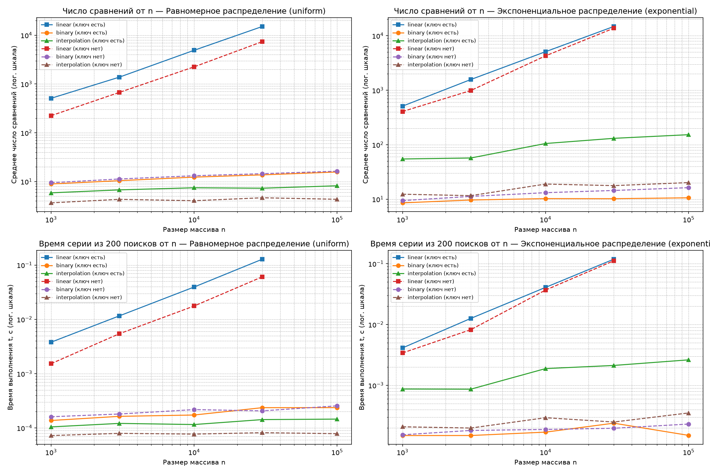

# Отчёт по лабораторной работе №6
**Тема:** Линейный, бинарный и интерполяционный поиск: сравнение  
**Вариант:** 7 (`seed = 37`)

---

## 1. Теоретические оценки сложности

| Алгоритм поиска | Лучший случай | Средний случай (uniform) | Худший случай (exponential / вырождение) | Дополнительная память |
|---|---|---|---|---|
| **Линейный (`linear_search`)** | $O(1)$ | $O(n)$ | $O(n)$ | $O(1)$ |
| **Бинарный (`binary_search`)** | $O(1)$ | $O(\log n)$ | $O(\log n)$ | $O(1)$ |
| **Интерполяционный (`interpolation_search`)** | $O(1)$ | $O(\log \log n)$ | $O(n)$ | $O(1)$ |

---

## 2. Верификация реализаций

В процедуре `self_check()` подтверждена корректность всех трёх алгоритмов:
1. **Граничные случаи:** корректно обработаны пустой массив `[]`, массив из одного элемента, массив из одинаковых элементов (проверка защиты от деления на ноль при $a[\text{hi}] == a[\text{lo}]$), первый и последний элементы, а также ключи, отсутствующие внутри и вне диапазона массива.
2. **Сверка с эталонами:** на 300 случайных тестах результаты поиска сверялись с функциями стандартной библиотеки (`bisect.bisect_left`, `in`, `list.index`). Для линейного поиска подтверждено возвращение первого вхождения дубликатов.

---

## 3. Результаты бенчмарков (медиана по 5 повторам)

### Распределение: `uniform` (равномерное)

| n | Ключ | Алгоритм | Среднее число сравнений | Время (с) |
|---:|---|---|---:|---:|
| 1000 | есть | linear | 509.0 | 0.003795 |
| | | binary | 8.9 | 0.000137 |
| | | interpolation | 5.9 | 0.000105 |
| 1000 | нет | linear | 224.2 | 0.001527 |
| | | binary | 9.5 | 0.000161 |
| | | interpolation | 3.7 | 0.000072 |
| 100000 | есть | binary | 15.7 | 0.000237 |
| | | interpolation | 8.2 | 0.000146 |
| 100000 | нет | binary | 16.3 | 0.000256 |
| | | interpolation | 4.3 | 0.000079 |

### Распределение: `exponential` (экспоненциальное)

| n | Ключ | Алгоритм | Среднее число сравнений | Время (с) |
|---:|---|---|---:|---:|
| 1000 | есть | linear | 510.2 | 0.004121 |
| | | binary | 8.6 | 0.000149 |
| | | interpolation | 54.7 | 0.000869 |
| 100000 | есть | binary | 10.6 | 0.000150 |
| | | interpolation | 152.7 | 0.002623 |
| 100000 | нет | binary | 16.3 | 0.000230 |
| | | interpolation | 20.2 | 0.000351 |

---

## 4. Анализ и выводы

1. **Превосходство интерполяционного поиска на равномерных данных:**  
   На равномерном распределении (`uniform`) интерполяционный поиск превосходит бинарный, совершая в среднем всего $\sim 4 - 8$ сравнений при $n = 100\,000$[cite: 16]. Это объясняется тем, что зонд вычисляется пропорционально значению ключа, сокращая область поиска с $n$ до $\log \log n$.
2. **Деградация интерполяционного поиска на неравномерных данных:**  
   На экспоненциальном распределении (`exponential`) значения сконцентрированы в начале диапазона. Формула интерполяции начинает делать некорректные шаги при поиске элементов в плотной зоне, из-за чего среднее число сравнений для присутствующих ключей при $n = 100\,000$ возрастает до $152.7$[cite: 17], приближая алгоритм к линейному перебору. В то же время бинарный поиск сохраняет стабильные $\sim 10 - 16$ сравнений независимо от характера распределения[cite: 17].
3. **Эффективность линейного поиска:**  
   Линейный поиск демонстрирует ожидаемый рост времени пропорционально $n$ (на $n = 30\,000$ время достигает $0.12$ с)[cite: 16], подтверждая нецелесообразность его использования на больших отсортированных массивах по сравнению с логарифмическими методами.

---

## 5. Ответы на контрольные вопросы

1. **Инвариант границ бинарного поиска:**  
   Замкнутый отрезок `[lo, hi]` всегда содержит искомый элемент, если он есть в массиве. Цикл `while lo <= hi` и сужение границ через `lo = mid + 1` / `hi = mid - 1` гарантируют обязательное уменьшение длины отрезка и предотвращают зацикливание.
2. **Когда бинарный поиск эффективнее линейного с учётом сортировки:**  
   Предварительная сортировка стоит $O(n \log n)$. Если к массиву выполняется серия из $K$ запросов, то бинарный поиск выгоднее линейного при $K > \log_2 n$.
3. **Принцип интерполяционного поиска и $O(\log \log n)$:**  
   Алгоритм оценивает позицию элемента по аналогии с поиском слова в словаре. На равномерных данных погрешность прогноза уменьшается как квадратный корень, давая сложность $O(\log \log n)$.
4. **Худший случай интерполяционного поиска и защита от него:**  
   Худший случай $O(n)$ достигается на экспоненциальных или геометрических прогрессиях, где формула смещает зонд всего на один элемент за шаг. Защитой служит гибридизация: при отсутствии быстрого сужения диапазона алгоритм принудительно переключается на бинарное деление пополам.