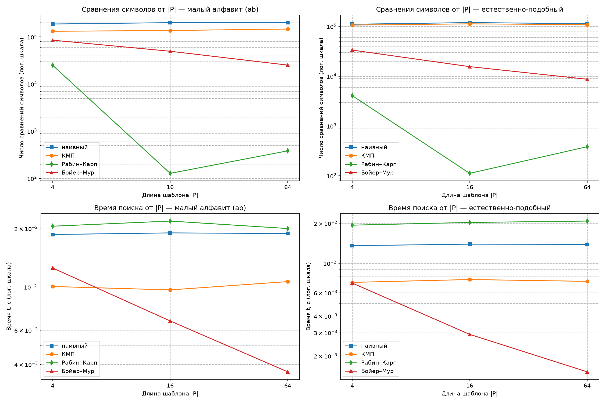

# Отчёт по лабораторной работе №7
**Тема:** Сравнительный анализ КМП, Рабина–Карпа и Бойера–Мура  
**Вариант:** 7 (`seed = 37`)

---

## 1. Теоретические характеристики алгоритмов

В таблице представлены асимптотические оценки времени и памяти для текста длины $n = |T|$ и шаблона длины $m = |P|$ (в зависимости от характера данных и числа совпадений):

| Алгоритм | Препроцессинг | Поиск (средний случай) | Поиск (худший случай) | Доп. память | Ключевая идея |
|---|---|---|---|---|---|
| **Наивный (`naive_search`)** | $0$ | $O(n)$ на большом алфавите | $\Theta((n - m + 1) \cdot m)$ | $O(1)$ | Посимвольная проверка слева направо со сдвигом на $1$ |
| **КМП (`kmp_search`)** | $\Theta(m)$ | $\Theta(n)$ | $\Theta(n)$ (не более $2n$ сравнений) | $\Theta(m)$ | Откат по префикс-функции $\pi[j-1]$ без возврата по тексту |
| **Рабин–Карп (`rabin_karp_search`)** | $\Theta(m)$ | $\Theta(n + k \cdot m)$, где $k$ — число вхождений | $\Theta((n - m + 1) \cdot m)$ при коллизиях | $O(1)$ | Скользящий полиномиальный хеш за $O(1)$ + посимвольная проверка при совпадении хешей |
| **Бойер–Мур (`boyer_moore_search`)** | $\Theta(m + |\Sigma|)$ | $O(n / m)$ (сублинейно) | $\Theta(n \cdot m)$ при перекрывающихся вхождениях | $\Theta(m + |\Sigma|)$ | Проверка справа налево; максимум сдвигов по эвристикам плохого символа и хорошего суффикса |

---

## 2. Верификация реализаций

В функции `self_check()` пройдены все проверки корректности (`self_check: OK`)[cite: 19]:
1. **Префикс-функция:** проверена на контрольных примерах `"abcabcd" -> [0, 0, 0, 1, 2, 3, 0]` и `"aabaaab" -> [0, 1, 0, 1, 2, 2, 3]`.
2. **Граничные случаи и перекрытия:** подтверждено нахождение всех перекрывающихся вхождений (`"aaaa"`, `"aa" -> [0, 1, 2]`), обработка пустого текста, пустого шаблона, шаблона длиннее текста и шаблона, равного тексту.
3. **Защита от коллизий в Рабине–Карпе:** проверена работа при малом модуле `mod = 3` на строке `"ababababa"`, где возникают многочисленные ложные совпадения хешей, которые успешно отсеиваются посимвольной проверкой окна.
4. **Сверка с эталоном:** на 300 случайных тестах над бинарным алфавитом `ab` списки всех вхождений у всех четырёх алгоритмов совпали с эталоном `reference_occurrences` на базе `str.find`.

---

## 3. Результаты бенчмарков (медиана по 5 повторам с прогревом)

### Таблица 1. Текст над малым алфавитом (`ab`), $|T| = 100\,000$[cite: 19]

| Длина шаблона $\|P\|$ | Алгоритм | Найдено вхождений | Сравнений символов | Время поиска $t$, с |
|---:|---|---:|---:|---:|
| **4** | Наивный | 6 248 | 187 232 | 0.018629 |
| | КМП | 6 248 | 131 325 | 0.010057 |
| | Рабин–Карп | 6 248 | 24 992 | 0.020553 |
| | Бойер–Мур | 6 248 | 85 081 | 0.012525 |
| **16** | Наивный | 8 | 199 987 | 0.018987 |
| | КМП | 8 | 136 364 | 0.009660 |
| | Рабин–Карп | 8 | 128 | 0.021846 |
| | Бойер–Мур | 8 | 49 556 | 0.006684 |
| **64** | Наивный | 6 | 200 721 | 0.018842 |
| | КМП | 6 | 146 523 | 0.010658 |
| | Рабин–Карп | 6 | 384 | 0.019999 |
| | Бойер–Мур | 6 | 25 196 | 0.003657 |

### Таблица 2. Естественно-подобный текст (словарь логов), $|T| = 99\,999$[cite: 19, 20]

| Длина шаблона $\|P\|$ | Алгоритм | Найдено вхождений | Сравнений символов | Время поиска $t$, с |
|---:|---|---:|---:|---:|
| **4** | Наивный | 1 022 | 110 335 | 0.013587 |
| | КМП | 1 022 | 106 271 | 0.007178 |
| | Рабин–Карп | 1 022 | 4 088 | 0.019393 |
| | Бойер–Мур | 1 022 | 33 451 | 0.007099 |
| **16** | Наивный | 7 | 119 224 | 0.013941 |
| | КМП | 7 | 112 412 | 0.007541 |
| | Рабин–Карп | 7 | 112 | 0.020326 |
| | Бойер–Мур | 7 | 15 560 | 0.002910 |
| **64** | Наивный | 6 | 113 283 | 0.013890 |
| | КМП | 6 | 108 342 | 0.007308 |
| | Рабин–Карп | 6 | 384 | 0.020824 |
| | Бойер–Мур | 6 | 8 691 | 0.001518 |

---

## 4. Анализ результатов и области применимости алгоритмов

1. **Влияние длины шаблона $|P|$ и размера алфавита на алгоритм Бойера–Мура:**
   * С ростом длины шаблона с $4$ до $64$ символов эффективность Бойера–Мура резко возрастает: на естественном тексте число сравнений сокращается с $33\,451$ до $8\,691$ ($\approx 0.087 \cdot |T|$), а время падает до $0.001518$ с (в $9$ раз быстрее наивного и в $4.8$ раза быстрее КМП)[cite: 19, 20]. Причина — большие скачки индекса текста при несовпадении с конца шаблона.
   * На малом алфавите (`ab`) эвристика плохого символа сама по себе даёт малые сдвиги (так как и `'a'`, и `'b'` встречаются вблизи правого края шаблона), однако совместное применение **эвристики хорошего суффикса** позволяет и здесь сократить число сравнений до $25\,196$ при $|P| = 64$ (время $0.003657$ с)[cite: 19].
2. **Стабильность алгоритма КМП на малом алфавите:**
   * На бинарном алфавите `ab` при коротком шаблоне ($|P| = 4$) КМП показывает лучшее время ($0.010057$ с против $0.012525$ с у Бойера–Мура и $0.018629$ с у наивного)[cite: 19].
   * Число сравнений КМП слабо зависит от длины шаблона ($131\,325 \dots 146\,523$ на `ab` и $106\,271 \dots 112\,412$ на естественном тексте)[cite: 19, 20], так как указатель по тексту никогда не движется назад.
3. **Поведение алгоритма Рабина–Карпа (сравнения символов против времени):**
   * При большом простом модуле $\text{mod} = 10^9 + 7$ ложных коллизий не возникло вовсе: число сравнений символов в точности равно $\text{число\_вхождений} \times |P|$ ($6248 \times 4 = 24\,992$, $8 \times 16 = 128$, $6 \times 64 = 384$)[cite: 19].
   * Несмотря на минимум посимвольных сравнений, время работы Рабина–Карпа составляет $\approx 0.020$ с на всех тестах из-за арифметических накладных расходов на пересчёт полиномиального хеша на каждой позиции текста[cite: 19, 20].
4. **Рекомендации по выбору алгоритма под задачу:**
   * **Бойер–Мур:** оптимальный выбор для поиска средних и длинных шаблонов ($|P| \ge 8$) в текстах над естественным алфавитом или логах ОС (ASCII/UTF-8).
   * **КМП:** предпочтителен для потоковой обработки данных (без буферизации и возврата назад), для текстов над малым алфавитом (ДНК-последовательности, бинарные потоки) при коротких шаблонах, а также в системах реального времени, где требуется гарантированная верхняя граница времени в худшем случае.
   * **Рабин–Карп:** целесообразен при одновременном поиске **множества шаблонов** одинаковой длины (достаточно проверить вхождение хеша окна в хеш-таблицу шаблонов за $O(1)$) или при поиске двумерных шаблонов.

---

## 5. Ответы на контрольные вопросы (раздел 10 КИМ-07)

1. **Построение префикс-функции и смысл $\pi[i]$:**  
   Значение $\pi[i]$ равно длине наибольшего собственного префикса подстроки `pattern[0..i]`, совпадающего с её суффиксом. При вычислении $\pi[i]$ берется длина $j = \pi[i-1]$ и проверяется совпадение `pattern[i] == pattern[j]`. При несовпадении выполняется переход к более короткому префиксу $j = \pi[j-1]$. Поскольку переменная $j$ за весь алгоритм увеличивается не более $m$ раз, суммарное число уменьшений в цикле `while` также не превышает $m$, что даёт линейную сложность $\Theta(m)$.
2. **Роль посимвольной проверки в алгоритме Рабина–Карпа:**  
   Хеш-функция отображает строки произвольной длины в конечное кольцо вычетов по модулю `mod`, поэтому различные подстроки могут иметь одинаковый хеш (коллизия). Без посимвольной проверки при равенстве `p_hash == t_hash` алгоритм возвращал бы ложные вхождения.
3. **Эвристика плохого символа в алгоритме Бойера–Мура и сублинейное число сравнений:**  
   Шаблон сравнивается с окном текста справа налево. При первом несовпадении на позиции $j$ шаблона с символом текста $c$ шаблон сдвигается вправо так, чтобы последнее вхождение символа $c$ в шаблоне совпало с текущей позицией текста: $\text{shift} = \max(1, j - \text{last}[c])$. Если символа $c$ нет в шаблоне вовсе ($\text{last}[c] = -1$), шаблон сдвигается сразу на $j + 1$ (при несовпадении на последнем символе — на всю длину шаблона $m$), пропуская до $m - 1$ символов текста без единого сравнения.
4. **Влияние размера алфавита на поведение алгоритмов:**  
   На большом алфавите вероятность совпадения случайного символа мала, поэтому Бойер–Мур делает максимальные прыжки по $m$ позиций и многократно опережает остальные методы. На малом алфавите (`{a, b}`) все буквы алфавита присутствуют в конце шаблона, что снижает шаг эвристики плохого символа до $1-2$ позиций; в этих условиях при коротких шаблонах выигрывает КМП, а при длинных — Бойер–Мур за счёт эвристики хорошего суффикса.